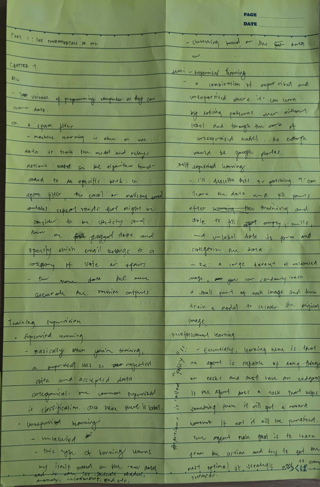
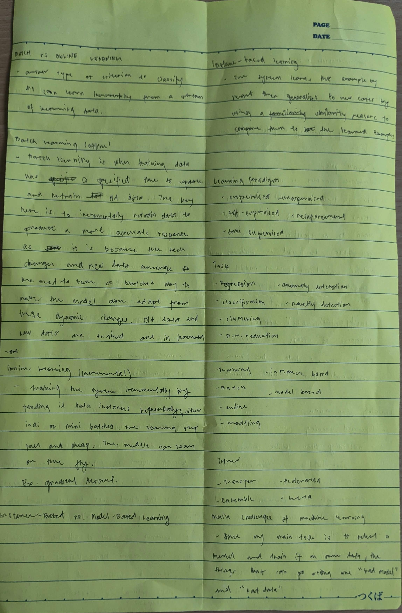
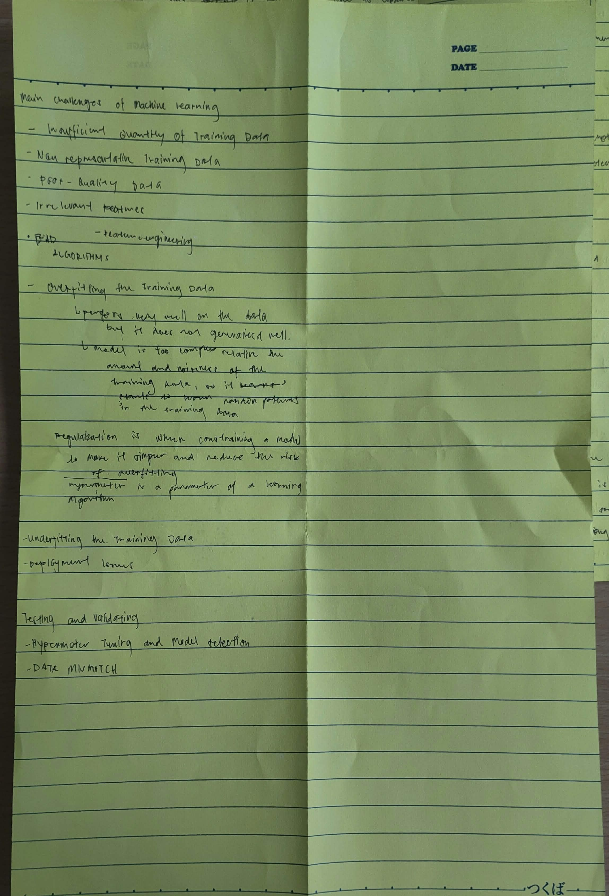

# Chapter 01 - The Machine Learning Landscape

> Status: ✅ Completed · Exercises: 11/19 (58%)

## Key Concepts

- **Machine learning** — programming computers so they can learn from data.
- **Spam filter example** — a model learns from emails with repeated/trigger words to classify new emails as spam or ham.
- **More data → more accurate** machine learning outputs.
- **Training supervision**
  - Supervised learning — training on labeled data (input + expected output); e.g. classification, regression.
  - Unsupervised learning — finding patterns in unlabeled data; e.g. clustering, anomaly detection, dimensionality reduction.
  - Semi-supervised learning — a mix of labeled and unlabeled data; e.g. Google Photos.
  - Self-supervised learning — learn from the data itself, then fill in missing labels (e.g. mask part of an image and reconstruct it).
  - Reinforcement learning — an agent learns from actions, rewards, and penalties to find an optimal strategy.
- **Batch vs online learning**
  - Batch learning — train on all data at a set time, then go offline; retrain when data changes.
  - Online learning (incremental) — learn continuously from a stream of incoming data (instances or mini-batches), on the fly.
- **Instance-based vs model-based learning**
  - Instance-based — memorizes examples and generalizes using a similarity measure.
  - Model-based — builds a model from the data and uses it to make predictions.
- **Main challenges** — insufficient training data, nonrepresentative data, poor-quality data, irrelevant features (feature engineering), overfitting, underfitting, and deployment issues.
  - Regularization constrains a model to keep it simpler and reduce overfitting.
  - A hyperparameter is a parameter of the learning algorithm that is set before training.
- **Testing and validating** — hyperparameter tuning and model selection, and data mismatch.

## Summary (in my own words)

Machine learning learns patterns from data instead of being explicitly programmed. Data can be labeled (supervised), unlabeled (unsupervised), mixed (semi-supervised), self-labeled (self-supervised), or learned through rewards (reinforcement). Systems can learn in batches or online, and can be instance-based or model-based. The main risks come from bad or insufficient data and from overfitting/underfitting, so validation, testing, and careful hyperparameter tuning are essential.

## Notes (handwritten)

## Questions / Things to Revisit

- [ ] Q8 — Spam detection: supervised vs unsupervised framing
- [ ] Q10 — Out-of-core learning
- [ ] Q12 — Model parameter vs hyperparameter
- [ ] Q13 — What model-based algorithms search for and how they predict
- [ ] Q18 — Train-dev set
- [ ] Q19 — What goes wrong when tuning on the test set

## Exercises

See `exercises.ipynb` for the full answers and self-marked report.

| # | Done | Notes |
| - | ---- | ----- |
| 1 | ✅ | Partial |
| 2 | ✅ | Correct |
| 3 | ✅ | Partial |
| 4 | ✅ | Correct |
| 5 | ✅ | Partial |
| 6 | ✅ | Correct |
| 7 | ✅ | Correct |
| 8 | ✅ | Incorrect |
| 9 | ✅ | Correct |
| 10 | ✅ | Incorrect |
| 11 | ✅ | Correct |
| 12 | ✅ | Incorrect |
| 13 | ✅ | Incorrect |
| 14 | ✅ | Partial |
| 15 | ✅ | Partial |
| 16 | ✅ | Partial |
| 17 | ✅ | Partial |
| 18 | ✅ | Incorrect |
| 19 | ✅ | Incorrect |
